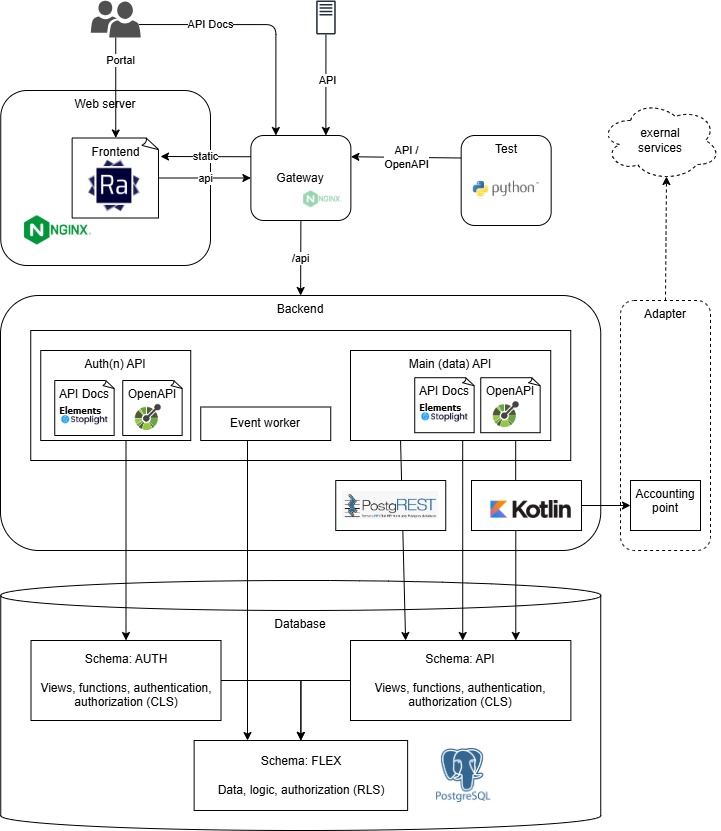
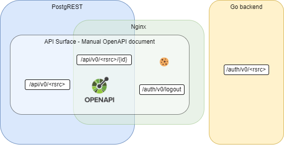

# Architecture

We are defining our software architecture according to
[Martin Fowler](https://youtu.be/DngAZyWMGR0?t=374)

> (shared understanding) [of] the important stuff (that is hard to change)

This document gives an overview of the software architecture of the Flexibility
Information System.

We are _not_ following any real structure in how we document the architecture.
We are aiming for "whiteboard models" or "tourist maps" as coined by
[Dave Farley](https://youtu.be/SYtkbv8LNv0?t=756).

## High level overview

This is how we envision an early platform for learning in our R&D project.

There are a handful of components in the drawing. Details of each are in the following
sections.

### Database - PostgreSQL

We are using PostgreSQL for the database.

In the diagram, the database is very big. This is intentional. We believe in
having a _thick database_. That means putting logic, like authorization and
consistency checking, in the database. This is counter to the thin database
approach, where in its extreme form the database is just a dumb storage of
"objects".

An interesting company in the "PostgreSQL for everything" space is
[Supabase](https://supabase.io/).

> Supabase is an open source Firebase alternative. We're building the features
> of Firebase using enterprise-grade open source tools.

While we are not suggesting going all in on Supabase, we are looking at
the open-source building blocks that Supabase is making use of, e.g., for REST
API, authn/z, etc.

### Backend - PostgREST + Kotlin

The Flexibility Information System will be API first. Regulations from EU
(Network Code Demand Response) and just the general idea of a central system
mandates programmable interfaces.

We currently have two APIs:

* **Auth API** - basically a security token service (STS) that issues and validates
  JWTs. It also provides userinfo.
* **Main API** - our main API that provides access to the data in the database.
  See the [API design documentation](./api-design.md) for more details.

Both of them are served by a backend built with Kotlin and the
[Ktor](https://ktor.io/) framework (kbackend).

The Main API relies on a component that generates REST APIs automatically from
the database. [PostgREST](https://postgrest.org/) is the leading open-source
tool for this. It provides us with a RESTish API by plugging into the database.
The backend checks the scopes of the caller, rewrites the request for PostgREST
(for example `embed` and `valid_at`) and forwards it.

#### Transition from Go

The backend used to be built with Go. We moved it to Kotlin because Kotlin
aligns better with other teams at Elhub. The Go backend no longer serves any
API requests: the gateway sends them directly to kbackend. The event worker
that creates notifications now runs as a job in kbackend (see
[Background jobs](#background-jobs)).

### Adapter

The adapter component is an external component responsible for making available
data from external sources on a format and interface that is compatible with the
Flexibility Information System. The adapter is not part of the system itself,
but it is an important part of the overall architecture.

The OpenAPI spec for the adapter is defined in this repository.

### Background jobs

The Kotlin backend can also be run in "job mode" to run background processes:

* **Data synchronisation** - Synchronisation of data from external sources is
  done in jobs (one per different source) running once in a while at a fixed
  frequency. Data is queried from the adapter and merged into the database after
  performing data quality checks.

* **Notification** - One of the jobs is long-running and is an _event worker_.
  It continuously handles events happening on the system and creates
  notifications to the users.

### Web Server - Static assets

We use NGINX as web server to serve static assets such as the frontend.

### Gateway

A gateway is used to serve frontend and backend/APIs from the same domain. In
dev/test we use Nginx for this.

### APIs - Application Programming Interfaces

For each of our APIs we ..

* describe them with an OpenAPI document.
* serve generated API documentation from the document.
* provide the functionality from the backend (kbackend, which uses PostgREST
  for the data), reverse proxied by NGINX.

For some details about the API design, see the [API design documentation](./api-design.md).

#### OpenAPI 3.1 - API spec

We manually maintain OpenAPI documents that describes the APIs we want to
expose. Some of the toil is removed by generating parts of the documents. We use
the [OpenAPI v3.1.0](https://spec.openapis.org/oas/v3.1.0) dialect.

The API provided by PostgREST is larger and a bit different from what we want to
expose. We "subtract" functionality by not documenting it in the OpenAPI
document and "add/augment" functionality in the backend. The following venn-like
diagram shows the API surface of the system. Some examples of what is realized
where are also shown.

* auth API is done by kbackend
* singular resources (`<rsrc>/{id}`) are done by PostgREST with some rewrites
  by kbackend
* plural resources (`<rsrc>`) are done by just PostgREST

To read about the API design, see the [API design documentation](../docs/api-design.md).

!!! info

    Everything is reverse-proxied through Nginx, which provides e.g. TLS
    termination. The diagram above just shows where the _functionality_ is
    implemented.

    kbackend only serves the routes that are in the API spec, so the rest of
    the PostgREST functionality is not reachable from outside.

#### (Generated) API Docs - Elements

The OpenAPI spec is used to generate API documentation. We are using
[Elements by Stoplight](https://github.com/stoplightio/elements) for this. It
has a very simple deployment model (html + js via CDN) and provides a
nice-enough UI for the API docs.

Tools that have been evaluated but did not make the cut:

* [Scalar](https://github.com/scalar/scalar). The UI is incorrect and generally
  lacking bad for models that are constructed using
  [composition](https://spec.openapis.org/oas/v3.1.0#composition-and-inheritance-polymorphism)
  (`allOf`).
* [Redoc](https://redoc.ly/) is pretty nice but does not display a combination
  of path, summary and description in a sufficient way.
* [Swagger UI](https://swagger.io/tools/swagger-ui/). The standard for OpenAPI
  documentation. The UI is not very nice and it is not very good at displaying
  the API in a way that is easy to understand.

### Documentation - Material for MkDocs

We are using
[Material for MkDocs](https://squidfunk.github.io/mkdocs-material/) to generate
the documentation that you are reading right now.

### Frontend - React Admin

We use [React Admin](https://marmelab.com/react-admin/) as the frontend
framework. This gives us a lot of functionality/plumbing out of the box and
allows us to spend little time on the front-end. If there is ever an investment
decision to make an actual information system, we assume that the frontend will
be rewritten to facilitate better UX and design.

An alternative front-end framework for quickly setting up a front-end in front
of such a REST API was [Refine](https://refine.dev/). We explored both options
but decided to use react-admin since it is very opinionated and thus easier to
get started with and understand. We value simplicity for flexibility.

### Test - Focus on the API

We focus our testing on testing the API.
