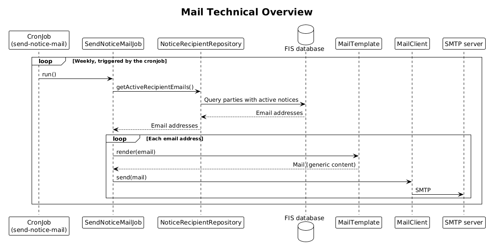

# Mail

This document describes the mailing solution: how it works and why decisions
are made as they are.

## Why do we need email?

In FIS, the purpose of a notice is to notify market actors outside the system.
The need comes from the functional aspect of FIS: actors do not necessarily
check FIS actively, which leaves notices open for longer periods. For the PSO
this is especially important for handling applications.

## Who gets the email, and why?

FIS operates with notices; see [the notice documentation](notice.md). Each
notice has a receiving party, which is mainly responsible for resolving the
notice. FIS searches for all active notices. For each active notice, we check
the receiving party and identify the relevant entity, provided that the entity
has a registered, valid email address.

## Mail content

For now, for security reasons, the content of the email is generic,
revealing no internal information from FIS, other than that the user needs to
log in to FIS and resolve the notices. Links or other data could be abused by
malicious third parties, who could copy our format and trick the user into
clicking a malicious link.

## Mail domain

// TODO

## Delivery guarantee

The initial implementation is optimistic and does not care whether a message
was sent successfully.

## Technical overview

[Full Size](diagrams/mail_overview.png)
|
[PlantUML description](diagrams/mail_overview.plantuml)

As of now, the solution lives in the Kotlin backend (kbackend), which can run
single jobs when the `JOB` environment variable is set. The mail job is
`send-notice-mail` and is triggered weekly by a cronjob, like the other jobs in
`kbackend/.../jobs`. When it runs, it queries the database to find relevant
entities that have an active notice. As long as the notice is active, the user
will receive a new email each time the job runs.

The job needs `MAIL_SMTP_HOST` and `MAIL_FROM`, and optionally
`MAIL_SMTP_PORT` (default 587), `MAIL_SMTP_USERNAME`, `MAIL_SMTP_PASSWORD` and
`MAIL_SMTP_STARTTLS` (default true), in addition to the database credentials.

Once the database query returns, kbackend receives a list of relevant email
addresses. Then, for each recipient, the email content is created. As of now,
the content is the same for every user. The `MailTemplate` is responsible for
creating and filling a templated email file. Once done, the `MailClient`
handles delivery of the email. As of now, sending emails is "fire and forget".
We also do not maintain any state of previously sent emails.

## What do we NOT do here?

We always "fire and forget" emails. Errors on the FIS side are logged. We never
wait for or verify that an email was sent successfully, nor do we keep a record
of who we have notified, when, and how often. Keeping such state might be added
later if more logic is incorporated into the mail channels. For now, it is left
out of the initial implementation for simplicity.
