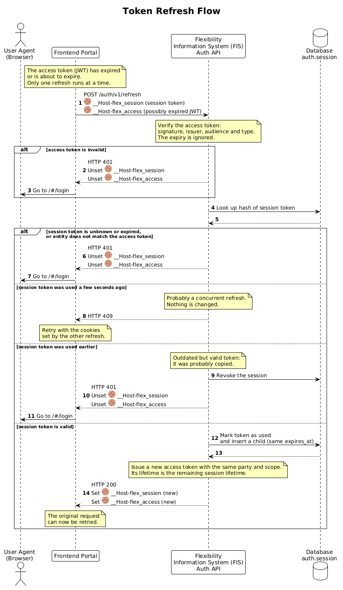
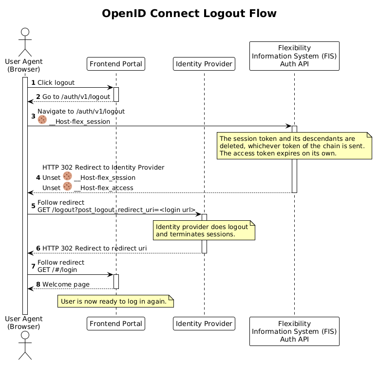

# Sessions

This document contains some information about how we deal with sessions and
implement the OpenID Connect protocol for login in portal.

## Overview

We will probably use
[IDPorten](https://docs.digdir.no/docs/idporten/oidc/oidc_auth_spa) as the
identity provider for persons using the production system via the portal.
IDPorten is based on OpenID Connect (OIDC).

In local dev we are using a OIDC compliant mock solution called
[Authelia](https://www.authelia.com/), while in external test environments, we
are using
[Oracle Cloud Identity and Access Management (IAM)](https://docs.oracle.com/en-us/iaas/Content/Identity/getstarted/identity-domains.htm)
(OCI IAM) and [Microsoft Azure Entra B2C](https://learn.microsoft.com/nb-no/entra/identity-platform/v2-protocols-oidc#fetch-the-openid-configuration-document).

In this diagram with refer to these solutions as the _Identity Provider_ (IDp).

## Backend For Frontend (BFF)

We are following the pattern known as
[Backend For Frontend](https://datatracker.ietf.org/doc/html/draft-ietf-oauth-browser-based-apps#name-backend-for-frontend-bff)
(BFF). The session token is opaque and kept in the database, and the access
token is a short-lived JWT (see [Tokens and sessions](#tokens-and-sessions)).
The cookie setting follows the cookie security recommendations, including the
[`__Host-` prefix.](https://datatracker.ietf.org/doc/html/draft-ietf-httpbis-rfc6265bis-19#name-the-__host-prefix).

We are using the OpenID Connect Authorization Code Flow with Proof Key for Code
Exchange (PKCE) and
[Pushed Authorization Requests](https://datatracker.ietf.org/doc/html/draft-ietf-oauth-par-06)
(PAR).

The following diagram shows the sequence of OIDC login and the BFF.

### Tokens and sessions

API calls are authenticated with **access tokens** which are short-lived (2 min),
signed JWTs. A JWT is validated by signature, never stored in the database, and
carries no personal information, only what is needed to authorise requests. The
user asks for a new access token when their current token expires.

Using only access tokens degrades user experience for users logging in through
the portal, as they regularly have to go through a whole new login flow to renew
their access tokens. Our previous, temporary solution was to have long-lived
access tokens (1h), but this is a security weakness as a stolen token gives
access on a long period of time, and it does not really solve the problem as
users still have to log out and in again every hour.

We are now using **session tokens** in addition to access tokens. Session tokens
are long-lived (12h), opaque tokens that represent the _entity_ connected to the
system. It does not give access to the API, but it can be used to regularly get
new access tokens based on what the entity can do in the system.

#### Refresh mechanism

We expose a dedicated refresh endpoint in the BFF that can be called whenever
the portal gets an authentication failure because the access token has expired.
If the session is still alive and represents a valid entity matching the expired
access token, the endpoint issues a new access token so that the user can
continue using the API. Optionally, the portal can also call the refresh
endpoint a little before expiry of the access token, to avoid most failed
requests for this reason.

The logic of the refresh endpoint is the one of the
[standard OAuth 2.0 `refresh_token` grant](https://www.rfc-editor.org/info/rfc6749/#section-6),
but we choose not to ask or return tokens in the body of requests and responses
on the refresh endpoint, and only transport them in cookies, for security
reasons. Tokens are also not accessible to JavaScript in the portal (`HttpOnly`).
The cookie storing the access token must live as long as the session, so that
it keeps being sent to the refresh endpoint to give information about the token
that must be refreshed. This information can be trusted even though the token
has expired, since it is signed.

#### Session lifecycle

Access tokens contain information that can be used directly, whereas opaque
tokens contain no claims, so the server must look up what a session token means.
This is done in a `session` database table. This table is `UNLOGGED` and kept
out of the audit mechanisms. Indeed, it only contains hashes, so there is
nothing worth restoring in case of crash for instance. Users will just log in
again when the system is restored.

A session is created at login. It represents _who_ is logged in and therefore
what they may do, independently of which tokens are currently valid. Here is
the content of the `session` table:

| Column       | Description                                                                                       |
|--------------|---------------------------------------------------------------------------------------------------|
| `id`         | SHA-256 hash of the session token (32 bytes).                                                     |
| `entity_id`  | The entity that logged in.                                                                        |
| `parent_id`  | The `id` of the token this one was issued from at refresh. `NULL` for the token created at login. |
| `expires_at` | Absolute end of the session. Copied unchanged from parent to child, so rotation never extends it. |
| `used_at`    | Set when the token has been exchanged for a new pair at refresh.                                  |

Session tokens are _rotated_: every refresh returns a new session token and
marks the previous one as used. We remember used tokens so as to detect reuse:
if an already used token is presented again, the whole session is revoked and
the user must log in again. Logging out also revokes the session. Revocation of
a session amounts to deleting the session token from the database. A cascading
delete will then delete all tokens in the `parent_id` chain.

With rotation every 2 minutes, a long-lived session creates hundreds of rows, so
deleting all sessions from the previous day is costly on the index. Instead, we
partition the `session` table with one partition per day. Cleaning old and
expired sessions can then be done by just dropping old partitions. We set up two
periodic jobs running inside the database with
[`pg_cron`](https://github.com/citusdata/pg_cron), like we already do for
some functionality (see for instance the notice sync in [Notices](./notice.md)).
One job creates partitions in advance, the other one drops the old partitions.
Partitioning is done based on the `expires_at` field. Since children tokens copy
it from the parent, we are sure that a whole token family will live in the same
partition chosen at login. As a result, for optimisation reasons, every query
against the `session` table has a time filter, so that the database can select
the right partition from the beginning.

#### Concurrent refreshes

Parallel requests failing at the same moment (the portal sends many at once)
try to refresh with the same token. Only one can win, but then it means that the
others present a used token, without it being a theft. Cookies are shared
between tabs, so a refresh from one tab updates all of them. To avoid logging
users out by accident:

* The portal only runs one refresh at a time per tab (a shared promise), and
  retries the failed requests when it resolves.
* A used token presented within a few seconds after `used_at` gets a retryable
  error (`409`) with no other effect. The client can retry with the cookies the
  winner set.

#### API access tokens

Tokens from the `/token` endpoint (`JWT Bearer`, token exchange) are not linked
to a session row and cannot be refreshed. Their lifetime is therefore longer
(10 minutes). We may consider adding a revocation list later, so that access
tokens can also be revoked even though we do not store them in the database.

#### Summary of operations

| Operation              | Effect                                                                                      |
|------------------------|---------------------------------------------------------------------------------------------|
| Login (`/callback`)    | Insert a session row. Issue an access token. Set both cookies.                              |
| Refresh                | Mark the session token used, insert a child. Issue a new access token with the same claims. |
| API call               | Verify the JWT signature and expiration time. No session lookup required.                   |
| Assume / unassume      | Issue a new access token. The session is unchanged.                                         |
| Logout, reuse          | Delete the session and its descendants, clear cookies.                                      |
| `/token` (API clients) | Issue a 10 minute JWT. No session.                                                          |

The following diagram shows a refresh, including the failure paths.

## Logout

Logout is also done via redirects between the Identity provider and the frontend.

The following diagram shows the sequence of OIDC logout.

## Assuming party

After the user has logged in, the user must
[assume a party](../docs/technical/authn-model.md). The `/assume`
endpoint is used by the frontend for this purpose.

## Ensuring compatibility between IDPorten and our mock/test IDP

The IDPorten OpenID Connect provider is picky about quite a few things. E.g. it
only supports the `RS256` alg, recommends PAR and stores the personal ID number
in a non-standard claim.

Our mock solution [Authelia](https://www.authelia.com/) and test solution
[OCI IAM](https://docs.oracle.com/en-us/iaas/Content/Identity/getstarted/identity-domains.htm)
are slightly different to IDPorten.

### OpenID configuration

One way to check the support of a given OpenID Connect provider is to check its
`/.well-known/openid-configuration` endpoint. The Authelia (local), OCI IAM and
IDporten endpoints are:

<!-- markdownlint-disable no-bare-urls -->
* https://idp.flex.internal:9091/.well-known/openid-configuration
* https://idporten.no/.well-known/openid-configuration
* https://idcs-64b43b9cb198438ca17360d2c5bd4b9f.identity.oraclecloud.com/.well-known/openid-configuration
* https://login.microsoftonline.com/common/v2.0/.well-known/openid-configuration

The `common` part in the Entra url will be replaced by the tenant ID in a real
setup.

### ID token format and claims

The ID token format at IDPorten is
[well documented](https://docs.digdir.no/docs/idporten/oidc/oidc_protocol_id_token).
The most important claim is `pid` - the Norwegian national ID number
(fødselsnummer/d-nummer) of the autenticated end user. This information is
stored in other claims in the other two solutions:

| Solution | Claim                | Description                             |
|----------|----------------------|-----------------------------------------|
| Authelia | `preferred_username` | The username of the authenticated user. |
| OCI IAM  | `sub`                | The subject of the authenticated user.  |
| IDPorten | `pid`                | Custom claim                            |
| Entra    | `preferred_username` | The email of the authenticated user.    |

> [!NOTE]
>
> We really
> [shouldn't use the `preferred_username` claim to identify the user](https://learn.microsoft.com/nb-no/entra/identity-platform/id-token-claims-reference#use-claims-to-reliably-identify-a-user).
> We are doing it because it is simple, but we should move to using the
> `sub`/`oid` claim.

### Logout endpoints

The logout endpoints are also a bit different. The biggest difference is that
Authelia actually does not fully support the OIDC logout flow yet, but it has
enough functionality to "make it work".

| Solution | Logout endpoint         | OIDC logout support | Redirect uri parameter     |
|----------|-------------------------|---------------------|----------------------------|
| Authelia | `/logout`               | no                  | `rd`                       |
| OCI IAM  | `/oauth2/v1/userlogout` | yes                 | `post_logout_redirect_uri` |
| IDPorten | `/logout`               | yes                 | `post_logout_redirect_uri` |
| Entra    | `/oauth2/v2.0/logout`   | yes                 | `post_logout_redirect_uri` |

!!! note "IDPorten logout not fully implemented"

    We have **not** built all the things we need to support
    [logout using IDPorten](https://docs.digdir.no/docs/idporten/oidc/oidc_protocol_logout.html).
    Like `id_token_hint` and front channel logout.

## OpenID Connect client

We are building the flow in our Kotlin backend. There are a few OIDC libraries
available for Kotlin. The most notable ones are:

* [Nimbus](https://connect2id.com/products/nimbus-oauth-openid-connect-sdk)
* [Ktor's OIDC plugin](https://ktor.io/docs/server-oidc.html)

Both of these build on OAuth 2. The problem with Nimbus is that it introduces a
new, non-standard dependency, and makes it harder to review the code migrating
away from Go. The problem with the Ktor plugin is that it is experimental and
lacks support for PAR.

We have decided to roll-our-own OIDC client like we did for Go, leaning only on
Ktor mechanisms (e.g. HTTP clients) and existing dependencies such as
`java-jwt` and `jwks-rsa` for the JOSE handling.

## Test user creation in Identity Providers

Test user creation in is manual in the authelia `users.yml` file.
