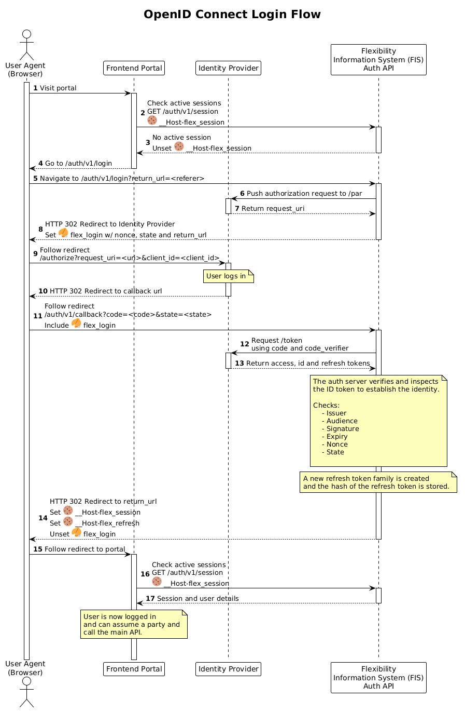

# Sessions

This document contains some information about how we deal with sessions and
implement the OpenID Connect protocol for login in portal.

## Overview

We will probably use
[IDPorten](https://docs.digdir.no/docs/idporten/oidc/oidc_auth_spa) as the
identity provider for persons using the production system via the portal.
IDPorten is based on OpenID Connect (OIDC).

In local dev we are using a OIDC compliant mock solution called
[Authelia](https://www.authelia.com/), while in external test environments, we
are using
[Oracle Cloud Identity and Access Management (IAM)](https://docs.oracle.com/en-us/iaas/Content/Identity/getstarted/identity-domains.htm)
(OCI IAM) and [Microsoft Azure Entra B2C](https://learn.microsoft.com/nb-no/entra/identity-platform/v2-protocols-oidc#fetch-the-openid-configuration-document).

In this diagram with refer to these solutions as the _Identity Provider_ (IDp).

## Backend For Frontend (BFF)

We are following the pattern known as
[Backend For Frontend](https://datatracker.ietf.org/doc/html/draft-ietf-oauth-browser-based-apps#name-backend-for-frontend-bff)
(BFF). To avoid having to deal with "sticky sessions", we are implementing using
"client-side sessions" as described. The cookie setting following the cookie
security recommendations, including the
[`__Host-` prefix.](https://datatracker.ietf.org/doc/html/draft-ietf-httpbis-rfc6265bis-19#name-the-__host-prefix).

We are using the OpenID Connect Authorization Code Flow with Proof Key for Code
Exchange (PKCE) and
[Pushed Authorization Requests](https://datatracker.ietf.org/doc/html/draft-ietf-oauth-par-06)
(PAR).

The following diagram shows the sequence of OIDC login and the BFF.

### Refresh tokens

To avoid asking the user to log in again every time their access token expires,
we use refresh tokens. Refresh tokens are long-lived, opaque tokens that can
only be used to get a new access token from a dedicated refresh endpoint in the
BFF. Like access tokens, they are stored in cookies and not accessible to
JavaScript in the portal. Whenever the portal gets an authentication failure
from the API, it calls the refresh endpoint to receive a new token and retries
the request. Optionally, it can also call the refresh endpoint a little before
expiry of the access token, to avoid most failed requests for this reason.

The logic of the refresh endpoint is the one of the standard OAuth 2.0
`refresh_token` grant, but we choose not to ask or return refresh tokens in the
body of requests and responses on the refresh endpoint, and only transport them
in cookies, for security reasons.

Server-side, refresh tokens are stored in a database table, as hashed values.
Refresh tokens are _rotated_: every refresh returns a new refresh token and
invalidates the previous one. All refresh tokens related to the same initial
login flow share a common session identifier. We remember used tokens so as to
detect reuse: if an already used token is presented again, the whole session is
revoked and the user must log in again. Revoking a session is done by deleting
all tokens from the same session. Logging out also revokes the session.

Sessions have a maximum age measured from the OIDC login (the first refresh
token issued). Refresh token rotation does not extend it, so a session can never
be kept alive forever, and at some point the user must log in again. Tokens from
expired sessions are deleted by a periodic cleanup job.

Here are the fields of the refresh token table:

| Column       | Description                                                                                          |
|--------------|------------------------------------------------------------------------------------------------------|
| `id`         | Primary key.                                                                                         |
| `token_hash` | Unique SHA-256 hash of the refresh token.                                                            |
| `session_id` | UUID shared by all tokens that come from the same login. Also stored in access tokens (`sid` claim). |
| `entity_id`  | The entity the token belongs to. Potentially used to alert users about token reuse for instance.     |
| `created_at` | When the token was issued.                                                                           |
| `expires_at` | When the token stops being valid.                                                                    |
| `used_at`    | Set when the token has been exchanged. Used for reuse detection.                                     |

The middleware reading the access token on regular calls can also check this
table to check whether there exists a valid session. If not, it means it got
revoked and so the used access token should not be allowed to be used on the API
even though it may still be valid.

The following diagram shows a refresh, including the failure paths.

## Logout

Logout is also done via redirects between the Identity provider and the frontend.

The following diagram shows the sequence of OIDC logout.

## Assuming party

After the user has logged in, the user must
[assume a party](../docs/technical/authn-model.md). The `/assume`
endpoint is used by the frontend for this purpose.

## Ensuring compatibility between IDPorten and our mock/test IDP

The IDPorten OpenID Connect provider is picky about quite a few things. E.g. it
only supports the `RS256` alg, recommends PAR and stores the personal ID number
in a non-standard claim.

Our mock solution [Authelia](https://www.authelia.com/) and test solution
[OCI IAM](https://docs.oracle.com/en-us/iaas/Content/Identity/getstarted/identity-domains.htm)
are slightly different to IDPorten.

### OpenID configuration

One way to check the support of a given OpenID Connect provider is to check its
`/.well-known/openid-configuration` endpoint. The Authelia (local), OCI IAM and
IDporten endpoints are:

<!-- markdownlint-disable no-bare-urls -->
* https://idp.flex.internal:9091/.well-known/openid-configuration
* https://idporten.no/.well-known/openid-configuration
* https://idcs-64b43b9cb198438ca17360d2c5bd4b9f.identity.oraclecloud.com/.well-known/openid-configuration
* https://login.microsoftonline.com/common/v2.0/.well-known/openid-configuration

The `common` part in the Entra url will be replaced by the tenant ID in a real
setup.

### ID token format and claims

The ID token format at IDPorten is
[well documented](https://docs.digdir.no/docs/idporten/oidc/oidc_protocol_id_token).
The most important claim is `pid` - the Norwegian national ID number
(fødselsnummer/d-nummer) of the autenticated end user. This information is
stored in other claims in the other two solutions:

| Solution | Claim                | Description                             |
|----------|----------------------|-----------------------------------------|
| Authelia | `preferred_username` | The username of the authenticated user. |
| OCI IAM  | `sub`                | The subject of the authenticated user.  |
| IDPorten | `pid`                | Custom claim                            |
| Entra    | `preferred_username` | The email of the authenticated user.    |

> [!NOTE]
>
> We really
> [shouldn't use the `preferred_username` claim to identify the user](https://learn.microsoft.com/nb-no/entra/identity-platform/id-token-claims-reference#use-claims-to-reliably-identify-a-user).
> We are doing it because it is simple, but we should move to using the
> `sub`/`oid` claim.

### Logout endpoints

The logout endpoints are also a bit different. The biggest difference is that
Authelia actually does not fully support the OIDC logout flow yet, but it has
enough functionality to "make it work".

| Solution | Logout endpoint         | OIDC logout support | Redirect uri parameter     |
|----------|-------------------------|---------------------|----------------------------|
| Authelia | `/logout`               | no                  | `rd`                       |
| OCI IAM  | `/oauth2/v1/userlogout` | yes                 | `post_logout_redirect_uri` |
| IDPorten | `/logout`               | yes                 | `post_logout_redirect_uri` |
| Entra    | `/oauth2/v2.0/logout`   | yes                 | `post_logout_redirect_uri` |

!!! note "IDPorten logout not fully implemented"

    We have **not** built all the things we need to support
    [logout using IDPorten](https://docs.digdir.no/docs/idporten/oidc/oidc_protocol_logout.html).
    Like `id_token_hint` and front channel logout.

## OpenID Connect client

We are building the flow in our Kotlin backend. There are a few OIDC libraries
available for Kotlin. The most notable ones are:

* [Nimbus](https://connect2id.com/products/nimbus-oauth-openid-connect-sdk)
* [Ktor's OIDC plugin](https://ktor.io/docs/server-oidc.html)

Both of these build on OAuth 2. The problem with Nimbus is that it introduces a
new, non-standard dependency, and makes it harder to review the code migrating
away from Go. The problem with the Ktor plugin is that it is experimental and
lacks support for PAR.

We have decided to roll-our-own OIDC client like we did for Go, leaning only on
Ktor mechanisms (e.g. HTTP clients) and existing dependencies such as
`java-jwt` and `jwks-rsa` for the JOSE handling.

## Test user creation in Identity Providers

Test user creation in is manual in the authelia `users.yml` file.
